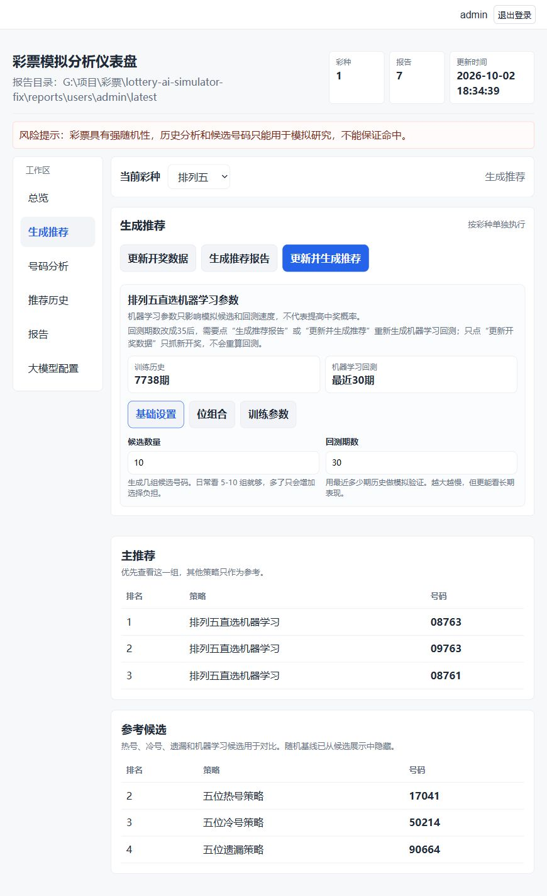
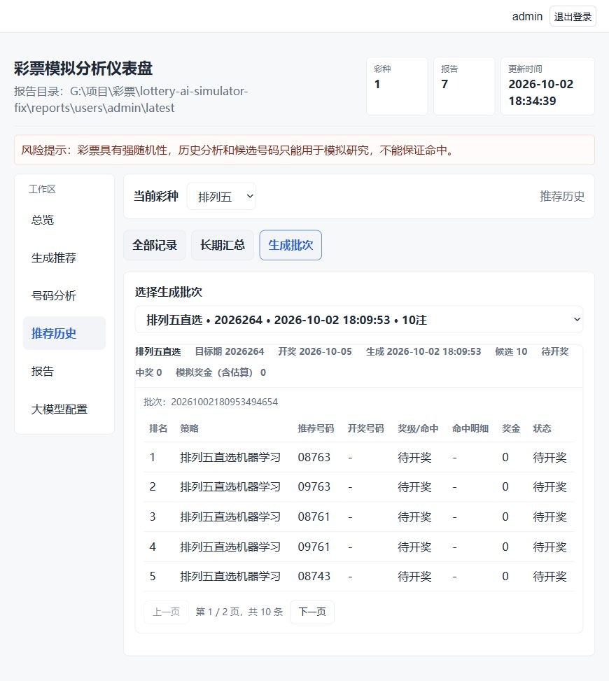

<div align="center">

# 彩票模拟分析系统

彩票历史数据分析与模拟推荐 Web 仪表盘

不承诺预测未来，只做可追踪、可校验、可复盘的彩票数据模拟分析。
 [🌐 友情链接linuxdo](https://linux.do/) 
</div>

## 1.2 版本

[下载 Windows 64 位免安装版](https://github.com/zxz0119/lottery-ai-simulator/releases/tag/1.2)。解压整个文件夹后运行 `lottery-ai-simulator.exe`，不要只复制 EXE。

本版修复中文编码、任务超时与错误处理，支持每位多个候选号码、OpenAI 兼容模型获取与总结；补充历史奖级规则、奖金口径、开奖数据纠错和模型缓存校验。界面保持原有风格，调整工作区与切换方式，减少长页面滚动。

### 新版界面

生成按钮位于参数上方，参数通过“基础设置 / 位组合 / 训练参数”切换；较宽屏幕并排显示候选结果。



推荐历史分为“全部记录 / 长期汇总 / 生成批次”，可选择具体批次，记录每页显示 5 条；报告按类型切换。




# 项目概述

这是一个面向本地个人研究的彩票历史数据分析项目。系统读取标准化开奖数据，结合彩票规则、统计特征、回测流程和机器学习候选生成，帮助用户在 Web 页面里完成开奖数据更新、候选号码生成、推荐记录保存和开奖后校验。

项目目标不是“保证命中”，而是把每一次模拟推荐都记录下来，等开奖后按真实规则回填结果，长期观察策略表现。


## 支持彩种

- 福彩3D
- 排列三
- 排列五
- 七乐彩
- 7星彩
- 快乐8
- 双色球
- 大乐透

## 核心功能

- 按彩种单独更新开奖数据，不强制一次执行所有票种。
- 使用热号、冷号、遗漏、统计特征和机器学习模型生成候选号码。
- 保存每次推荐记录，按彩种和目标期号管理历史。
- 开奖后自动校验推荐记录，统计命中等级、中奖金额和长期表现。
- Web 仪表盘提供总览、候选号码、推荐历史、长期汇总和原始报告。
- 本地 SQLite 保存执行历史、推荐快照、训练记录和大模型配置。
- Web 任务使用 SSE 实时显示进度；分析页展示号码频率、遗漏排行、和值区间、分区走势和候选评分解释。
- 后台配置页支持 OpenAI 兼容接口的模型获取、连接测试、主动生成并保存 AI 总结、训练记录查看和 CSV/HTML 导出。

## 工作流程

1. 更新某个彩种的历史开奖数据。
2. 基于最新历史数据生成下一期候选号码。
3. 推荐记录写入本地历史库。
4. 开奖数据更新后，系统校验历史推荐是否命中。
5. Web 总览展示推荐数量、待开奖数量、中奖记录和奖金统计。

## 环境要求

- Python 3.10 或更新版本。1.2 的完整测试及 Windows EXE 使用 Python 3.12。
- PowerShell。项目脚本位于 `scripts/`，适合 Windows PowerShell 直接执行。
- 浏览器。Web 仪表盘默认监听本机 `127.0.0.1:8765`。
- 网络访问。更新开奖数据时会从数据源拉取历史开奖文本；也可以通过命令参数传入本地数据文件。

项目核心逻辑和内置本地 Web 服务主要使用 Python 标准库。`requirements.txt` 中的 `fastapi` 和 `uvicorn` 用于推荐的 FastAPI Web 服务模式。

## 安装依赖

在项目目录打开 PowerShell，推荐使用项目本地虚拟环境运行：

```powershell
python -m venv .venv
.\.venv\Scripts\Activate.ps1
python -m pip install --upgrade pip
python -m pip install -r requirements.txt
```

如果只想使用内置本地服务，可以不安装 `requirements.txt`，启动时指定 `--server stdlib`。

## Web 版本启动

推荐使用 FastAPI 服务：

```powershell
.\.venv\Scripts\Activate.ps1
$env:PYTHONPATH='src'
python -m lottery_sim.cli dashboard --server fastapi --reports reports/latest --host 127.0.0.1 --port 8765
```

或者使用自动模式：优先尝试 FastAPI；如果没有安装 FastAPI，会切换到内置本地服务。

```powershell
.\.venv\Scripts\Activate.ps1
$env:PYTHONPATH='src'
python -m lottery_sim.cli dashboard --reports reports/latest --host 127.0.0.1 --port 8765
```

强制使用内置本地服务：

```powershell
.\.venv\Scripts\Activate.ps1
$env:PYTHONPATH='src'
python -m lottery_sim.cli dashboard --server stdlib --reports reports/latest --host 127.0.0.1 --port 8765
```

浏览器访问：

```text
http://127.0.0.1:8765
```

进入页面后，先选择彩种，再执行“更新开奖数据”“生成推荐报告”或“更新并生成推荐”。

## 本地数据

历史开奖数字保存在：

```text
data/normalized/
```

推荐记录、报告、模型和执行历史都是本地运行产物，可重新生成，默认不提交到 GitHub。

## 风险声明

彩票开奖结果具有强随机性。项目中的统计分析、机器学习候选和历史回测只能用于模拟研究，不能作为确定性预测依据，也不构成任何投注建议。

## 多用户服务模式

FastAPI 仪表盘支持账号登录、注册和用户工作区隔离。服务启动时会根据环境变量创建一个初始账号，新用户也可以在登录页点击“注册新账号”自助创建：

```powershell
$env:LOTTERY_ADMIN_USER='admin'
$env:LOTTERY_ADMIN_PASSWORD='change-this-password'
$env:PYTHONPATH='src'
python -m lottery_sim.cli dashboard --server fastapi --reports reports/latest --host 0.0.0.0 --port 8765
```

默认账号密码：

```text
账号：admin
密码：admin
```

如果没有设置 `LOTTERY_ADMIN_PASSWORD`，系统会自动创建 `admin / admin`。默认密码只在文档中说明，登录页和启动输出不会展示。正式部署或给多人使用前，请务必设置自己的管理员密码。

共享开奖基础数据：

```text
data/normalized/
```

每个用户独立保存推荐记录、报告、模型、导出文件和 AI 配置：

```text
data/users/<username>/
reports/users/<username>/
```

内置 stdlib 服务仍作为本地单用户备用模式；多人使用请启动 FastAPI 模式。

## Docker 服务

推荐用 Docker Compose 在服务器、NAS 或局域网机器上运行多人服务：

```powershell
$env:LOTTERY_ADMIN_USER='admin'
$env:LOTTERY_ADMIN_PASSWORD='change-this-password'
$env:TZ='Asia/Shanghai'
docker compose up -d --build
```

浏览器访问：

```text
http://localhost:8765
```

常用命令：

```powershell
docker compose logs -f
docker compose down
```

Compose 会挂载本地持久化目录：

```text
./data:/app/data
./reports:/app/reports
```

Docker 默认使用 `Asia/Shanghai` 时区。页面里的生成时间来自容器本地时间；如果服务器在其他时区，可以在启动前修改 `TZ` 环境变量。已运行过旧镜像时，建议重新构建并重建容器：

```powershell
docker compose up -d --build --force-recreate
```

Docker 镜像包含 PowerShell Core，因为后台工作流复用了 `scripts/` 下的 PowerShell 自动化脚本。

## Windows EXE 打包

在 PowerShell 中执行：

```powershell
.\scripts\build_exe.ps1
```

打包结果：

```text
dist\lottery-ai-simulator\lottery-ai-simulator.exe
```

双击 `lottery-ai-simulator.exe` 会启动本地 FastAPI 仪表盘并自动打开浏览器，默认地址是：

```text
http://127.0.0.1:8765
```

如果已经有一个实例在运行，再次双击会直接打开已有仪表盘页面，不会因为端口占用直接退出。

如果启动失败，EXE 会在同目录写入：

```text
startup-error.log
```

把这个日志发给维护者即可定位具体原因。

EXE 包已包含 Python 运行时。后台任务会通过同一个 exe 的 `--cli` 模式执行，不要求使用者额外安装 Python。

EXE 运行数据保存在打包目录旁边：

```text
dist\lottery-ai-simulator\data\
dist\lottery-ai-simulator\reports\
```

`dist/`、`build/` 和 `*.spec` 已加入 `.gitignore`，不会上传到 Git。发布时可以手动把 `dist\lottery-ai-simulator\` 压缩后上传到 GitHub Release。

APK 打包不包含在当前版本中。

## 旧版升级与数据保留

1. 关闭旧版服务，备份旧安装目录的整个 `data/` 和 `reports/`。
2. 将新版压缩包解压到一个新目录。
3. 将旧版 `data/` 和 `reports/` 完整复制到新版 EXE 所在目录，保留子目录结构，再运行新版。

不要删除旧目录，直到确认账号登录、历史推荐、配置及报告正常。数据库 `data/app.sqlite3` 保存账号；`data/users/<username>/history.sqlite3` 保存用户配置和执行记录，不能只复制开奖 CSV。

新版继续使用原来的数据路径，兼容旧版推荐 CSV 和 SQLite。首次读取旧历史数据库时，自动添加奖金口径字段，并先在同目录保存 `history.sqlite3.pre-1.2.bak`（单用户数据库同样使用原文件名加 `.pre-1.2.bak`）。原有账号密码、模型配置和推荐批次保留；旧记录缺少奖金依据时标为估算。备份失败会中止迁移。

原报告可继续查看；旧报告不会自动改写。需要应用新的奖级规则与统计口径时，请重新生成报告。旧模型缓存不符合校验条件时会在下一次生成时重新训练。

源码升级仍保留本地 `data/`、`reports/`；Docker 升级保留挂载卷，重新构建镜像即可。


### 位组合与大模型配置

福彩3D、排列三、排列五、七星彩在“生成推荐”的“位组合”标签里启用每位多个号码，设置各位候选数量。模型按评分选出各位号码；可按评分生成前 N 注，或生成全部组合（最多1000注）。七星彩最后一位范围为0—14。页面显示组合池、生成注数及模拟投入，报告和保存记录使用同一组参数。

后台配置默认使用 OpenAI 兼容协议。填写 API 基础地址（例如 https://api.example.com/v1）和密钥后点击“获取模型”，选择模型或手动填写模型 ID。获取列表使用 /models，连接测试和总结使用 /chat/completions。列表接口不可用时仍可手动配置文本模型。

“保存配置”“测试连接”“生成总结”分别执行独立操作，保存配置不会调用模型。总结根据当前工作区报告生成，每份报告最多使用1500字、长期汇总最多10000字；生成成功后保存时间、模型及报告结果，刷新页面只读保存结果。密钥留空保留已有密钥。

奖级按开奖期号适用规则判断，报告注明官方、固定或估算奖金；缺少当期实际单注奖金或奖池/派奖状态时，相关金额标记估算。金额为模拟票面奖金，未扣税，不代表实际领取收益。2025、2026年的休市安排已加入；其他年份目标日期仍属估计。
